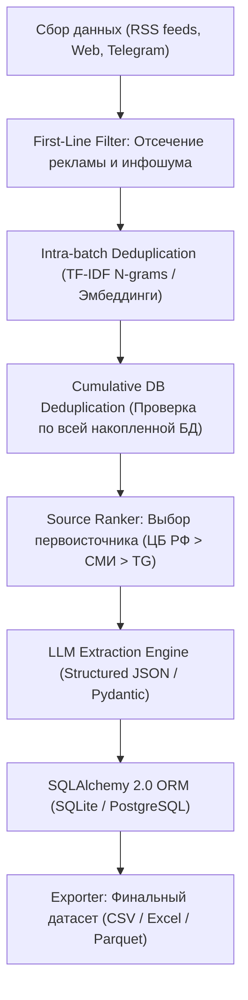

# NewsParser: Модульная система сбора, фильтрации, дедупликации и аналитической разметки экономических новостей

Production-ready система на Python для автоматического мониторинга, интеллектуальной фильтрации, семантической дедупликации и структурированной разметки экономических и отраслевых новостей (макроэкономика, банковский сектор, недвижимость, девелопмент).

Разработана в строгом соответствии с требованиями отраслевого **Технического задания (ТЗ)** и алгоритмами научной статьи CyberLeninka (смысловая нормализация, авторитетность первоисточников) и современных практик новостных пайплайнов (Habr / `nyan`).

---

## 📌 1. Архитектура и ключевые инженерные решения

Система построена на модульном конвейере (Pipeline) с четким разделением ответственности:



### Почему гибридная схема LLM (Structured Outputs) вместо классического LSTM?
1. **Сложные предикаты и отрицания:** Классический LSTM/GRU плохо справляется с пониманием смысловых отрицаний («ставка не изменена» vs «изменение ставки», «лимиты не исчерпаны») и составными условиями («повышение взноса с 20% до 30%»).
2. **Нулевой порог разметки (Zero-Shot / Few-Shot):** Для обучения LSTM потребовались бы десятки тысяч размеченных текстов под 15 специализированных классов. LLM извлекает сущности и фактоиды по строгой Pydantic-схеме из коробки.
3. **Двухуровневый пайплайн скорости и экономии:** Тяжелая LLM вызывается **только** для уникальных, отфильтрованных от рекламы новостей. Весь инфошум и повторы отсекаются быстрыми алгоритмами на первом и втором этапах.

---

## 📋 2. Соответствие требованиям ТЗ

### Строгий рубрикатор групп
Поддерживается канонический вид (`M01–M10`, `H01–H05`) с авто-нормализацией кириллических букв:
- **`M01`**: Денежно-кредитная политика (ключевая ставка ЦБ РФ, риторика Банка России).
- **`M02`**: Кредитование и сбережения (потреб./корп. кредиты, вклады). *Правило: ипотека сюда НЕ относится.*
- **`M03`**: Инфляция (ИПЦ, инфляционные ожидания, прогнозы).
- **`M04`**: Доходы и занятость (зарплаты, реальные доходы, безработица, дефицит кадров).
- **`M05`**: Экономическая активность (ВВП, промпроизводство, инвестиции, заводы).
- **`M06`**: Валютный рынок (курсы USD/EUR/CNY, валютный контроль).
- **`M07`**: Внешняя торговля и санкции (экспорт, импорт, логистика, пошлины).
- **`M08`**: Бюджет и господдержка (госрасходы, налоги, субсидии, маткапитал). *Правило: льготная ипотека — в H02.*
- **`M09`**: Демография и миграция (численность населения, рождаемость, домохозяйства).
- **`M10`**: Сырье, энергия и транспорт (нефть, газ, тарифы ЖКХ). *Правило: стройматериалы — в H04.*
- **`H01`**: Рыночная ипотека (ставки без льгот, первоначальный взнос, условия банков).
- **`H02`**: Льготные жилищные программы (Семейная, IT-ипотека, лимиты, завершение программ).
- **`H03`**: Рынок жилья (цены за кв.м, спрос, объемы продаж, скидки и рассрочки застройщиков).
- **`H04`**: Строительство (себестоимость, эскроу, ввод жилья, стройматериалы, банкротства девелоперов).
- **`H05`**: Территория и инфраструктура (дороги, школы, благоустройство, зонирование).

### Извлечение ключевых фраз (`keywords`)
- Строго от 5 до 10 содержательных фактологических фраз через разделитель `; `.
- Формула факта: `[фактор] + [действие/направление] + [числовые параметры с ед. изм.] + [статус] + [организация/субъект]`.
- Сохранение отрицаний (`«ставка не повышена»` вместо `«изменение ставки»`).
- Полный запрет на пустые слова-паразиты (`«новость»`, `«ситуация»`, `«эксперты»`, `«рынок»`).

### Фильтрация рекламы и дедупликация
- **Реклама:** Отсекаются пустые призывы («успейте купить», «лучшие квартиры», «скидка до N%» без условий, erid-токены). Если застройщик публикует конкретные условия (рассрочка 0% на 2 года, взнос 20%) — новость сохраняется, а реклама вычищается.
- **Дедупликация:** Кластеризация перепечаток и пересказов одного события. В датасет записывается ровно 1 запись на уникальное событие со ссылкой на первоисточник (приоритет: официальные органы ЦБ РФ/ведомства -> деловые СМИ -> Telegram). Исходный текст публикации в итоговый датасет не пишется.

---

## 🗂 3. Финальная структура датасета (11 колонок)

| Колонка | Тип | Описание |
|---|---|---|
| `news_id` | str / UUID | Уникальный идентификатор записи |
| `published_at` | str (ISO/Date) | Дата и время публикации (без домысливания времени, если известна только дата) |
| `collected_at` | str (ISO) | Дата и время сбора публикации |
| `source_name` | str | Название издания, ведомства или канала |
| `source_type` | str | `официальный источник` \| `СМИ` \| `компания` \| `Telegram-канал` |
| `url` | str | Прямая ссылка на конкретную публикацию |
| `main_group` | str | Код основной группы (`M01`–`M10`, `H01`–`H05`) |
| `additional_groups` | str | Коды дополнительных групп через запятую или пустая строка |
| `keywords` | str | 5–10 фактологических фраз через `; ` |
| `geography` | str | Страна, регион РФ, город (фокус: Россия, Челябинская область) |
| `comment` | str | Служебные пометки (битая ссылка, спорная классификация). Пересказ текста запрещен |

---

## 💻 4. Структура проекта

```text
NewsParser/
├── .env.example              # Образец конфигурации (БД, API LLM: OpenAI, DeepSeek, Ollama)
├── Reference/                # ТЗ и материалы исследования (CyberLeninka, Habr, nyan)
├── src/
│   ├── config.py             # Настройки приложения (Pydantic Settings)
│   ├── schemas.py            # Pydantic-схемы (валидация 11 полей датасета, правил рубрикатора)
│   ├── main.py               # Точка входа в CLI интерфейс
│   ├── pipeline.py           # Оркестратор сквозного конвейера обработки
│   ├── exporter.py           # Экспорт записей в стандартизированный CSV (utf-8-sig)
│   ├── database/
│   │   └── models.py         # SQLAlchemy 2.0 ORM модели и менеджер сессий
│   ├── scrapers/
│   │   ├── rss_scraper.py    # Сборщик RSS (РБК, Ведомости, Коммерсантъ, 74.ru, Банк России)
│   │   └── telegram_scraper.py # Сборщик Telegram-каналов (веб-превью без API-ключей и дампы)
│   ├── processing/
│   │   ├── filter.py         # First-Line фильтр рекламы и кликбейта (Раздел 6 ТЗ)
│   │   └── deduplicator.py   # Семантический поиск дубликатов и выбор первоисточника (Раздел 5 ТЗ)
│   └── analysis/
│       └── llm_annotator.py  # LLM-разметка Structured JSON + отказоустойчивый эвристический fallback
└── tests/
    ├── test_schemas.py       # Тесты валидации схемы датасета и ключевых фраз
    └── test_processing.py    # Тесты фильтрации рекламы, дедупликации и авторитетности источников
```

---

## 🚀 5. Быстрый старт

### 1. Установка зависимостей
Требуется Python 3.10+:
```bash
pip install -r Reference/nyan-master/requirements.txt
pip install sqlalchemy feedparser beautifulsoup4 lxml openai pydantic-settings pytest
```

### 2. Настройка окружения
Создайте файл `.env` в корне проекта (на основе `.env.example`):
```env
# База данных
DATABASE_URL=sqlite:///data/news.db

# LLM провайдер (поддерживается OpenAI, DeepSeek, vLLM, локальная Ollama)
LLM_API_KEY=ollama
LLM_BASE_URL=http://localhost:11434/v1
LLM_MODEL=qwen2.5:7b

# Либо для OpenAI:
# LLM_API_KEY=sk-...
# LLM_BASE_URL=https://api.openai.com/v1
# LLM_MODEL=gpt-4o-mini
```

### 3. Запуск конвейера через CLI

- **Запуск полного цикла (сбор, фильтрация, дедупликация, LLM-разметка и экспорт)**:
  ```bash
  python -m src.main --action run --output data/final_news_dataset.csv
  ```

- **Сбор только сырых новостей**:
  ```bash
  python -m src.main --action collect
  ```

- **Экспорт накопленной базы данных в CSV**:
  ```bash
  python -m src.main --action export --output data/final_news_dataset.csv
  ```

- **Запуск unit-тестов**:
  ```bash
  python -m pytest tests
  ```

